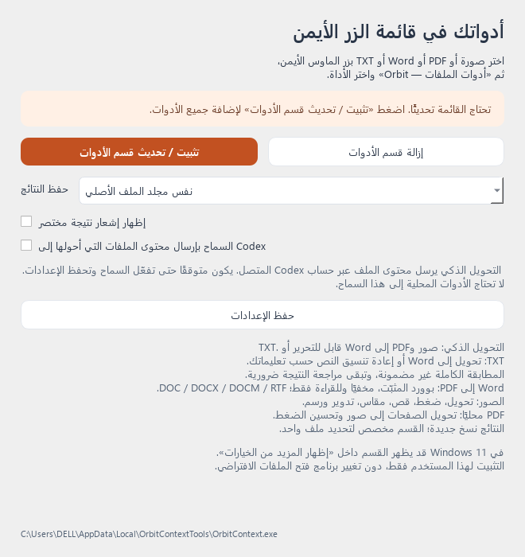

# Orbit Context

[العربية](README.ar.md)

Windows Explorer context-menu tools for images, PDF, Word and TXT. Version **1.2**.



## Features

- Image conversion, compression, cropping, resizing, rotation and annotation.
- PDF page-to-image conversion and lossless compression attempts.
- Word to PDF through an owned, invisible Microsoft Word instance.
- Images/PDF to editable Word or text using the locally installed Codex CLI.
- TXT to Word, or TXT formatting with saved custom instructions.
- Same-folder output by default, collision-safe names, cancellation and temporary-file cleanup.

The Explorer menu runs one selected file at a time. The settings window does not open for each operation. Windows 11 may place the menu under **Show more options**.

## Download and install

Open **Releases**, download `Orbit-Context-Windows-v1.2.zip`, extract it, and run `OrbitContext.exe`. Click **تثبيت / تحديث قسم الأدوات** once, then close the settings window. Right-click a supported file and choose **أدوات الملفات — Orbit**.

Registration is per-user and does not change default file associations. The executable is copied to `%LOCALAPPDATA%\OrbitContextTools\OrbitContext.exe`. The same manager removes the registered menu. The binary is unsigned.

## Requirements and privacy

- Windows 10/11, x64.
- Microsoft Word desktop, installed and activated, for Word-to-PDF and optional layout review.
- Installed, authenticated Codex CLI for smart conversion. No separate API key is requested by this app.

Local image/PDF tools do not call Codex. Smart conversion sends selected page images/text to the model service using the connected Codex account and its usage limits. Enable the explicit Codex permission in settings before using it. Codex running on the device **does not mean offline inference**.

Editable reconstruction is approximate. Text uses native editable Word text boxes and tables; graphics remain image crops. The current reconstruction font is Arial. Text boxes retain positions rather than continuous paragraph flow; added text may require resizing. OCR, complex tables and unavailable fonts can differ from the original. Review important results. The default smart-conversion limits are 40 pages and 1,000,000 bytes for TXT.

## Run from source

Use Python **3.14** on Windows. The release was built with Python 3.14.0.

```powershell
python -m venv .venv
.\.venv\Scripts\Activate.ps1
python -m pip install -r requirements.txt
python app/orbit_context.py
```

The source manager can show settings. Installing the Explorer menu requires the compiled executable.

## Build

```powershell
.\scripts\build.ps1 -InstallDependencies
```

The standalone executable is written to `dist/OrbitContext.exe`. The script uses the repository's spec and does not require paths from the original developer's machine.

## Verify

```powershell
python -m compileall -q app tests
python -m unittest discover -s tests -v
```

The Windows workflow runs these offline checks and builds a downloadable executable artifact. Word/Codex integration checks are manual and opt-in: see [testing](docs/TESTING.md). They are not run in CI and can consume Codex usage.

## Project layout

| Path | Purpose |
|---|---|
| `app/` | Application modules and extended diagnostic scripts |
| `tests/` | Portable offline smoke checks |
| `scripts/build.ps1` | Build entry point |
| `OrbitContext.spec` | PyInstaller configuration |
| `docs/` | Architecture, testing and release manifest |
| `licenses/` | Third-party notices from the original distribution |

This project was organized from the supplied v1.2 release archive. Its original Windows executable is distributed separately in Releases, rather than committed into source history. The radial-menu Orbit Files project is separate.

## License

GNU AGPL v3 or later; see [LICENSE](LICENSE) and [NOTICE](NOTICE). Third-party components retain their licenses. Microsoft Word and Codex CLI are not bundled.
